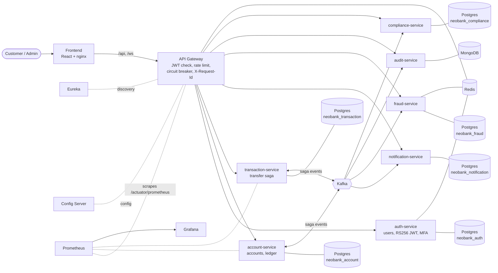
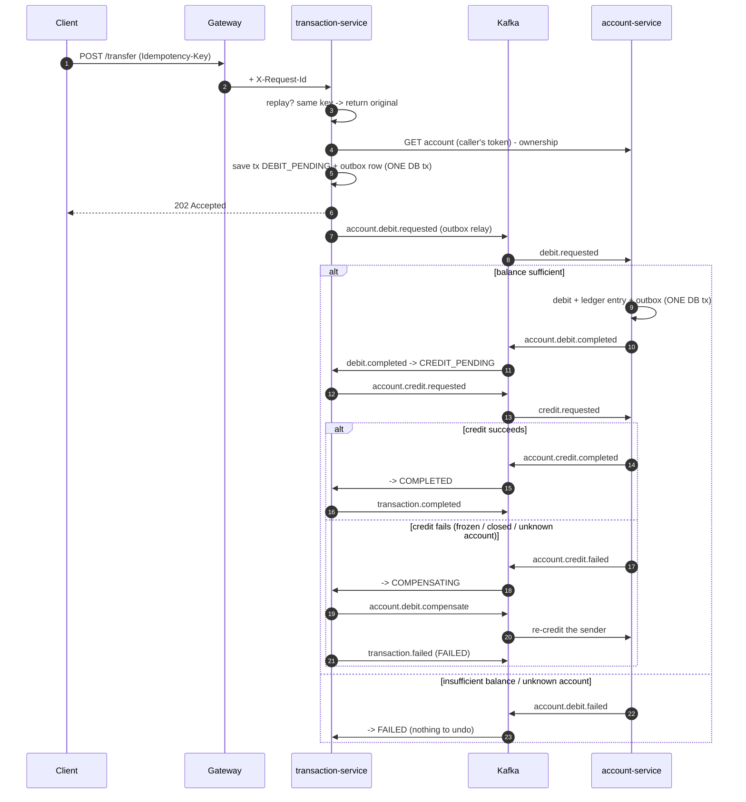
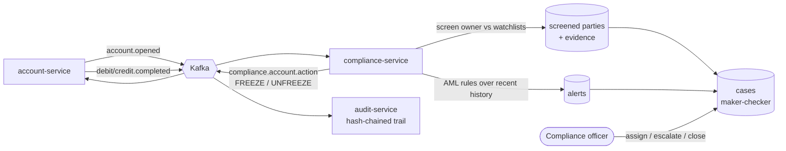
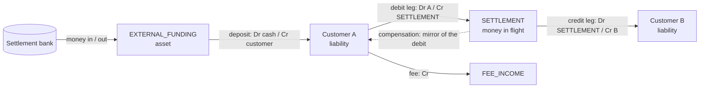

# Architecture

## System context and containers

Each service owns its own database (database-per-service). Services never read each other's tables; they exchange
facts as Kafka events. The only synchronous service-to-service call is `transaction-service → account-service`
(ownership check at transfer initiation, using the caller's own token).

## The transfer saga (choreography)

State machine in `transaction-service`: `INITIATED → DEBIT_PENDING → CREDIT_PENDING → COMPLETED`, with
`DEBIT_PENDING → FAILED` and `CREDIT_PENDING → COMPENSATING → FAILED` on the failure branches.
`notification-service`, `fraud-service` and `audit-service` consume the same topics independently (own consumer groups).

## Compliance flow

An exact-name sanctions hit freezes the account automatically; every other finding goes to a person. Both functions are driven by
events, so compliance never sits in the payment path. See [ADR 0006](adr/0006-compliance-service.md).

## Money model (double-entry)

Every arrow is one balanced journal. `SETTLEMENT` nets to zero when nothing is in flight; `EXTERNAL_FUNDING` is what
the settlement bank's statement is reconciled against. See [ADR 0005](adr/0005-double-entry-ledger.md).

## Reliability building blocks

| Concern | Mechanism | Where |
|---|---|---|
| Never lose an event / never publish one for a rolled-back change | **Transactional outbox**: event row written in the same DB tx as the state change, relayed to Kafka by a poller | `OutboxRelay` (account, transaction) |
| Kafka delivers at-least-once | **Idempotent consumers**: `processed_events` row inserted in the same tx as the side effect | every consumer |
| Client retries | **Idempotency-Key** with unique index | `POST /transfer` |
| Poison messages | Retry with backoff → **`<topic>.DLT`** + metric + alert | `KafkaErrorHandlingConfig` |
| Failure mid-saga | **Compensation** (debit reversal) | `TransferService.onCreditFailed` |
| Customer on a sanctions list | Screening at onboarding + on every list import; exact match freezes automatically | compliance-service |
| Laundering patterns | Pure AML rules, alert dedup, one open case per account | compliance-service |
| Risky decisions | Maker-checker (four-eyes) on SAR filing and clearing a frozen hit | compliance-service |
| Tampering with the audit trail | SHA-256 hash chain + checkpoints + verification API | audit-service |
| Cached balance vs truth | **Double-entry journal** (balanced by DB trigger, append-only) + trial balance / drift audit (ShedLock'd) | account-service |
| Books vs the bank | Statement reconciliation with tracked breaks | account-service |
| Spending reserved money | **Holds** under the same row lock as the saga | account-service |
| Concurrent updates | Optimistic locking (`@Version`) + `SELECT … FOR UPDATE` on the saga path | account-service |
| N replicas | **ShedLock** on `@Scheduled` jobs | account, transaction |
| Unbounded tables | Retention jobs for sent outbox rows and `processed_events` | `OutboxCleanupJob` |

## Security

RS256 JWTs signed by auth-service and verified by every other service via its JWKS endpoint (no shared secret);
httpOnly/Secure/SameSite=Strict cookies; refresh-token rotation; account lockout; Redis-backed rate limits;
TOTP MFA with step-up for large transfers (single-use, bound to the caller); object-level authorization on accounts
and transactions; role-based access (ADMIN) for fraud and audit; AES-GCM PII encryption with an HMAC blind index for
email lookup. Secrets are generated per checkout (`scripts/bootstrap-env.sh`) and never committed.

## Observability

Metrics (Prometheus/Grafana, business + JVM + HTTP), distributed tracing (Micrometer → Zipkin), structured JSON logs
carrying `traceId` and `requestId`, health endpoints used by Docker `HEALTHCHECK` and Kubernetes probes, alert rules in
`observability/alerts.yml`. See the README and [runbook](runbook.md).

## Deployment

`docker-compose.yml` for local development (health-gated startup, optional observability profile) and `k8s/` for a
cluster (StatefulSets for data stores, Deployments + HPAs for services, Ingress). CI builds and scans every image and
pushes to GHCR from `main`.
